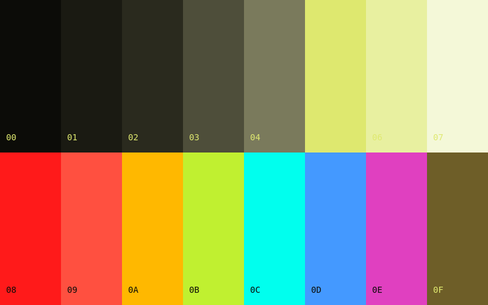
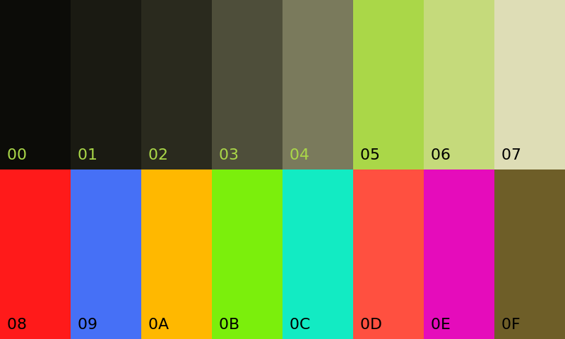

# Runner Shell

A [base16](https://github.com/tinted-theming/home) color scheme featuring Marathon-inspired neon accents on an olive/chartreuse base.

## Palette

| Base | Hex       | Role                    |
|------|-----------|-------------------------|
| 00   | `#0c0c08` | Olive Black (bg)        |
| 01   | `#1a1a12` | Dark Olive (lighter bg) |
| 02   | `#2a2a1e` | Olive Gray (selection)  |
| 03   | `#4e4e3a` | Muted Olive (comments)  |
| 04   | `#7a7a5c` | Khaki Dim (dark fg)     |
| 05   | `#dee86f` | Chartreuse (text)       |
| 06   | `#e8f0a0` | Pale Lime (emphasis)    |
| 07   | `#f4f8d8` | Cream White (headings)  |
| 08   | `#ff1a1a` | Signal Red (errors)     |
| 09   | `#4499ff` | Cobalt Bright (constants) |
| 0A   | `#ffb800` | Hard Gold (classes)       |
| 0B   | `#c0f030` | Marathon Neon (strings)   |
| 0C   | `#00ffee` | Neon Cyan (regex)         |
| 0D   | `#ff5040` | Hot Coral (funcs)         |
| 0E   | `#e040c0` | Hot Magenta (keywords)  |
| 0F   | `#6e5e28` | Olive Gold (special)    |

## Preview



## Runner Shell QD

An alternative tuned for QD-OLED monitors. QD-OLED pixels put the green subpixel above red and blue, so text in colors that light both rows (white, cream, chartreuse, cyan) shows a green fringe along the top and a pink one along the bottom. Runner Shell QD moves those colors toward a single subpixel row and dims them slightly, staying within ~12° of the original hues. Backgrounds, red, gold and coral are unchanged: coral's only fringe-free shade is base08's red, and gold has none.

| Base | Runner Shell              | Runner Shell QD           | Fringe  |
|------|---------------------------|---------------------------|---------|
| 05   | `#dee86f` Chartreuse      | `#aad748` Lime            | 45 → 36 |
| 06   | `#e8f0a0` Pale Lime       | `#c5da7b` Pale Lime       | 50 → 43 |
| 07   | `#f4f8d8` Cream White     | `#deddb6` Bone            | 57 → 51 |
| 09   | `#4499ff` Cobalt Bright   | `#4670f6` Cobalt          | 47 → 39 |
| 0B   | `#c0f030` Marathon Neon   | `#7bef0c` Marathon Neon   | 37 → 24 |
| 0C   | `#00ffee` Neon Cyan       | `#12ebc3` Neon Cyan       | 50 → 43 |
| 0E   | `#e040c0` Hot Magenta     | `#e50cbb` Hot Magenta     | 23 → 0  |

Fringe is the OKLab distance between a color's top and bottom text edges on base00 (green-only above, red+blue-only below) and the nearest proper antialiasing shade; lower is better. Primary text keeps 11.7:1 contrast.



## Usage

Use with any base16 template builder or copy the values directly into your theme configuration.

### NixOS/Stylix

```nix
stylix.base16Scheme = ./runner-shell.yaml;
# or, on a QD-OLED monitor:
stylix.base16Scheme = ./runner-shell-qd.yaml;
```

## License

MIT
